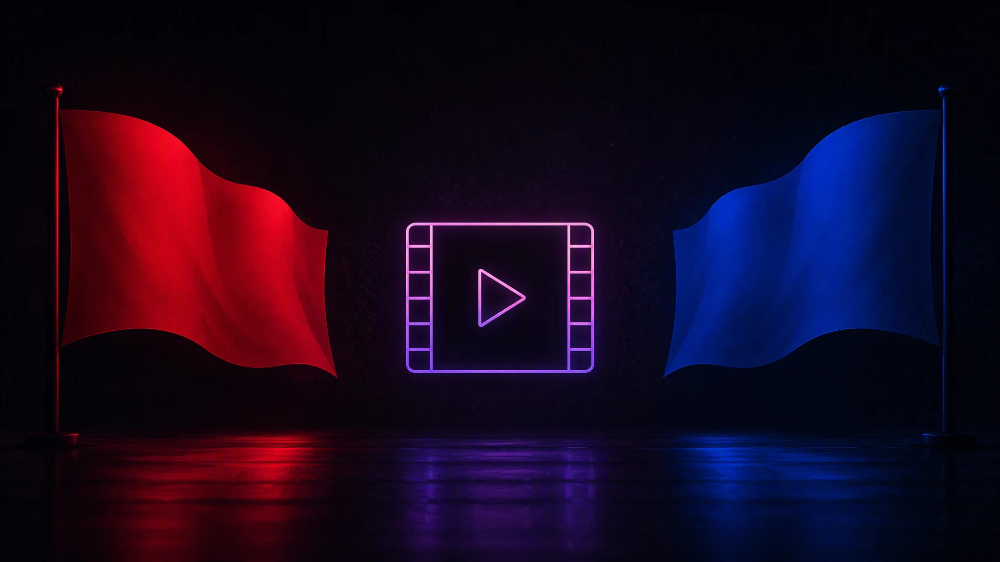

# Tape Operator — Selfhost Edition

Самохостинговая версия скрипта [Tape Operator](https://github.com/Kirlovon/Tape-Operator). Плеер и API-прокси живут на вашем собственном сервере — браузер не обращается ни к tapeop.dev, ни к api.kinobox.tv напрямую, что снимает блокировки РКН на этих доменах.

> **Важно:** для части источников видео по-прежнему может понадобиться VPN — сами iframe грузятся браузером напрямую с чужих CDN.

## Возможности

- 🚩 Два флажка на странице фильма: красный слева — ваш плеер, синий справа — запасной вариант (поиск на Яндексе)
- 🎬 Плеер на вашем домене и порту, статика через nginx
- 🔀 Прокси к Kinobox API с эмуляцией браузера (TLS-имперсонация Chrome) — обходит антибот-фильтр API
- 📡 Автообновление userscript с этого репозитория
- 🖥️ Работает на IMDB, TMDB, Кинопоиске и Letterboxd

## Установка

1. Установите расширение для userscript'ов: [Tampermonkey](https://www.tampermonkey.net/) (рекомендуется), Violentmonkey, Greasemonkey или Userscripts.
2. [Разрешите выполнение userscript'ов и режим разработчика](https://www.tampermonkey.net/faq.php?locale=ru#Q209) в браузере.
3. Установите скрипт: https://github.com/sanek1mz/Tape-Operator/raw/selfhost/userscript/tape-operator.user.js (либо вручную из папки `userscript/`).

Откройте страницу фильма на одном из поддерживаемых сайтов и нажмите флажок: **красный (слева)** открывает ваш плеер, **синий (справа)** — поиск фильма на Яндексе (запасной вариант, если плеер не нашёл фильм или источники не работают).

> Флажок не появился? Проверьте, что скрипт включён в дашборде расширения, и перезапустите браузер.

## Самохостинг

Плеер раздаётся статикой через nginx, например: `https://sanek2mz.duckdns.org:8443/player/`.

- Конфиг nginx: [deploy/nginx-tape-operator.conf](deploy/nginx-tape-operator.conf)
- Прокси API: [deploy/kinobox_proxy.py](deploy/kinobox_proxy.py) + systemd-юнит [deploy/kinobox-proxy.service](deploy/kinobox-proxy.service)
- Обновление на сервере: `deploy/update.sh`

Подробности устройства и развёртывания — в [deploy/](deploy/).

## Отказ от ответственности

Проект не хранит и не распространяет пиратский контент. Все права на материалы принадлежат их законным владельцам; для удаления незаконного контента обращайтесь к первоисточнику. Автор не несёт ответственности за содержание сторонних ресурсов.

**Пиратство — плохо.**

## Лицензия

MIT, см. [LICENSE](LICENSE). Форк проекта [Kirlovon/Tape-Operator](https://github.com/Kirlovon/Tape-Operator).